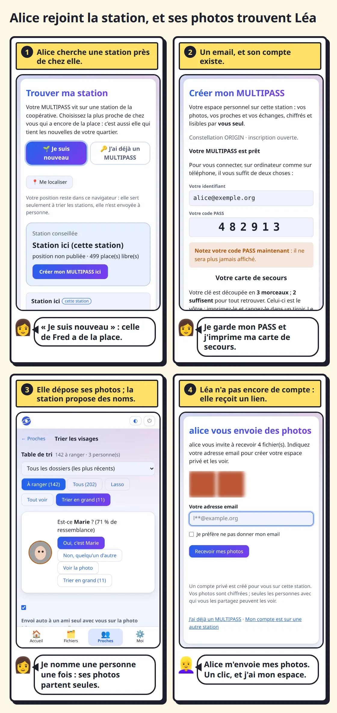
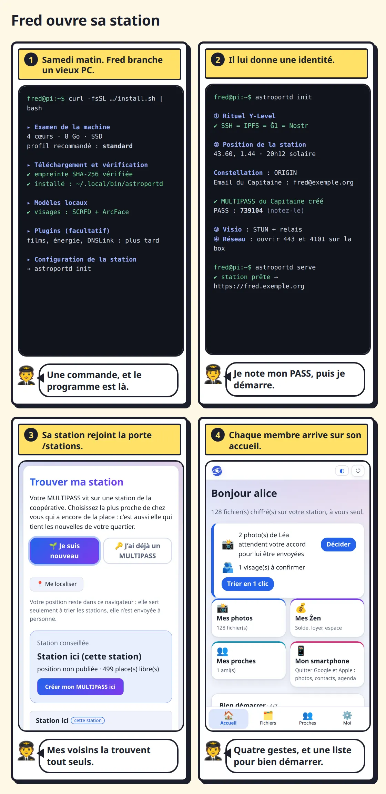
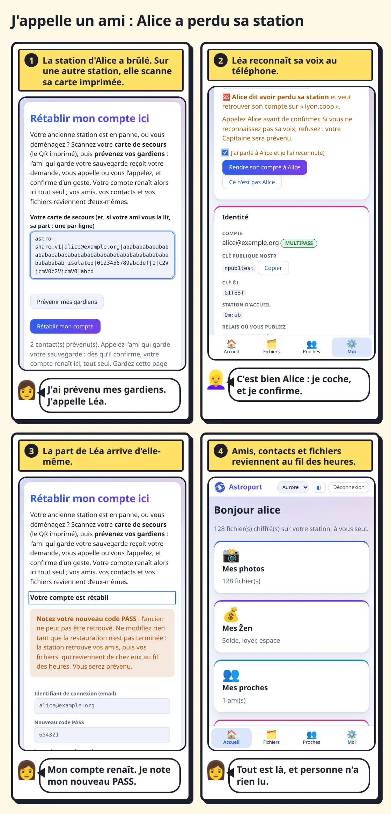

# astroportd

[](LICENSE)
[](https://github.com/papiche/astroportd/releases)
[](https://github.com/papiche/astroportd/actions/workflows/ci.yml)

**Votre cloud, vos photos, vos amis et votre économie coopérative, sur une machine qui est à vous.**
astroportd est une **station personnelle** : un seul programme, de quelques dizaines de Mo, qui tient sur un Raspberry Pi
comme sur un serveur GPU. Il garde vos fichiers **chiffrés**, retrouve les visages dans vos photos et les partage avec
vos amis, vous fait **sauvegarder par vos proches** (et retrouver votre compte si votre machine brûle), et fait tourner
une **comptabilité coopérative en Ẑen** (monnaie libre Ğ1) — sans plateforme, sans abonnement, sans serveur central.
C'est le cœur souverain d'[Astroport.ONE](https://github.com/papiche/Astroport.ONE) et d'UPlanet, réécrit en Rust.

> **Version 1.5.0.** Testé de bout en bout (≈ 1 020 tests, `clippy` sans avertissement) ; lisez aussi
> [les limites connues](#10-limites-connues). Licence **AGPL-3.0** · Auteur : Fred (support@qo-op.com) · Rust 2024 (≥ 1.85).

**Par où commencer ?** Découvrir sans rien installer : [la page d'accueil](docs/index.html) · Ouvrir sa station :
[Démarrer en 5 minutes](#démarrer-en-5-minutes), puis le [guide du Capitaine illustré](docs/guide.html) · Comprendre
le réseau : [les écluses](#de-lintime-au-public--les-écluses) et [les constellations](docs/CONSTELLATIONS.md) ·
Contribuer : [l'architecture](#2-vue-densemble).



---

## Ce que vous pouvez faire avec astroportd

| Je veux… | astroportd… |
|---|---|
| **Garder mes fichiers chez moi**, accessibles partout | Un cloud personnel (`uCloud`) **chiffré avant de quitter l'appareil**, monté comme un disque réseau (WebDAV : Finder, Explorateur Windows, mobile) et dans le navigateur. Contacts et agenda se synchronisent avec le téléphone (CardDAV, CalDAV). |
| **Retrouver mes photos par visage** et les partager entre amis | `FaceCloud` reconnaît les visages et envoie les photos à vos amis **chiffrées, directement à leur station**. Une photo de groupe attend votre accord. |
| **Faire entrer quelqu'un** dans le réseau en lui envoyant une photo | Un **lien d'invitation** (ou un QR) : la personne crée son compte en un geste, ou l'accepte avec le sien, même sur une autre station ; ses photos arrivent. |
| **Ne rien perdre si ma machine tombe en panne** | Un ami que je choisis héberge une **copie chiffrée** que moi seul peux lire. Avec ma **clé de secours** (QR) et la part de cet ami (« j'appelle un ami »), je rétablis mon compte sur n'importe quelle station : tout revient de soi-même. |
| **Changer de station** (déménager chez un Capitaine plus proche) | Le même parcours : la nouvelle station s'annonce comme ma maison, l'ancienne cesse d'héberger mon compte. |
| **Parler entre amis**, sans plateforme | Un **relai Nostr** intégré, des conversations privées chiffrées, des **appels visio** de navigateur à navigateur, et un cercle social à deux niveaux (amis N¹, amis d'amis N²). |
| **Choisir jusqu'où mes données circulent** | Le Capitaine règle sa station en un geste : **Forteresse**, **Village** ou **Place publique** ([les écluses](#de-lintime-au-public--les-écluses)). |
| **Faire vivre une économie coopérative** | Une comptabilité en **Ẑen** adossée à la Ğ1 : règle des 3×1/3, registre signé, micro-dons par simple réaction `+N`, billets papier. |
| **Avoir un assistant** qui me connaît | **BRO** : une mémoire personnelle à recherche vectorielle locale (`sqlite-vec`), avec **votre** IA (Ollama, ou une clé que vous déclarez). |

**Pour qui ?** Un **membre** s'inscrit sur la station d'un Capitaine (ou la sienne) ; un **Capitaine** héberge des membres et
règle sa station ; un **développeur** étend l'ensemble par des plugins WebAssembly.

## Ce qui le distingue

Beaucoup d'outils font une partie de cela. astroportd les réunit **dans un seul programme que vous possédez**, avec des
choix que les services habituels ne font pas :

| Domaine | Services habituels | Alternatives libres / P2P | Ce que fait astroportd |
|---|---|---|---|
| **Fichiers et synchronisation** | Google Drive, Dropbox, Nextcloud | Filecoin, Sia, IPFS Desktop | Chiffrement **UENC v2** (flux authentifié par blocs de 64 Kio, lecture partielle `Range`), déduplication par CID, et un **manifeste de votre cloud ancré sur Nostr** : la base SQLite n'est qu'un cache, tout se rejoue. |
| **Photos et visages** | Google Photos, Apple Photos | Immich, PhotoPrism | Photos **chiffrées**, empreintes de visages 512D **cloisonnées par propriétaire** (`sqlite-vec`), partage vers les amis reconnus par messages chiffrés **NIP-59/NIP-17**, avec validation de l'utilisateur dans la zone de doute. |
| **Identité et réseau social** | Keybase, X, Mastodon | Urbit, Farcaster, clients Nostr | Une **identité dérivée de votre clé SSH** (Y-Level : SSH, IPFS, Ğ1 et Nostr sont la même clé) et un **pare-feu social NIP-42** réglé en trois modes : seuls les membres du cercle publient, et tout contenu non public exige d'être authentifié dans le cercle. |
| **Sauvegarde et reprise** | Sauvegarde cloud payante | Syncthing, Tahoe-LAFS | Des **amis réciproques hébergent votre copie chiffrée** (ils ne peuvent rien lire), et restituent **d'eux-mêmes** après une panne : la **clé de secours** (QR) plus la part d'un ami suffisent à retrouver compte, contacts et fichiers sur une autre station. |
| **Communication entre machines** | Tailscale, ZeroTier, ngrok | libp2p, Iroh | Tunnels **« DRAGON »** natifs `/x/<service>-<PeerID>` sur le maillage libp2p, sans ouvrir de port sur la box : découverte mDNS sur le réseau local, stations relais publiées par la configuration coopérative (`P2P_RELAYS`), adresses annoncées dans la balise ; une politique réglée par le Capitaine dit qui peut ouvrir quel service. |
| **Économie et monnaie** | OpenCollective, Stripe | DAO, Lightning | Comptabilité coopérative adossée à la **monnaie libre Ğ1** (Duniter v2s) : **règle des 3×1/3**, registre Ğ1-N² signé et chaîné, **micro-dons sur réaction Nostr `+N`**. Le Ẑen est une unité comptable de la coopérative, pas une monnaie publique. |

Ce qu'on ne prétend pas : astroportd n'est pas un réseau social grand public, ni un service hébergé. C'est **votre** station,
avec ses [limites connues](#10-limites-connues).

---

## L'application phare : FaceCloud + partages N¹ / N² entre uCloud


Vos photos sont **chiffrées avant de quitter l'appareil**, puis FaceCloud y reconnaît les visages (≥ 0,82 ; entre 0,55
et 0,82, il vous demande « est-ce X ? »). Une photo part **seule** chez un ami réciproque quand il y est **seul avec
vous** (score ≥ 0,88) ; sinon elle attend votre clic, et toujours en mode Forteresse. Pour les autres : un **lien
secret** `/s/<slug>#clé`, dont la clé ne quitte jamais le navigateur. Les films (NIP-71) ne vont qu'au cercle N¹ de
l'auteur ([§9](#9-films-et-séries--la-copie-privée)).

> **À savoir.** Les visages se calculent par un service HTTP (`--face-engine`) ou en local (`--face-models`, ONNX,
> inclus dans les archives Linux gnu et macOS). Sans l'un ni l'autre, uCloud marche sans visages.

Pas à pas : [FaceCloud dans le guide](docs/GUIDE.md#etape-8).

---

## De l'intime au public : les écluses


Le Capitaine choisit un mode dans *Ma station › Réseau › Écluses* : **Forteresse** (amis réciproques seulement, pas
d'inscription libre), **Village** (le défaut) ou **Place publique** (tout le monde publie). Sans redémarrer.

- **`/_/`** range à part le coffre, les contacts et l'agenda : ni FaceCloud, ni miniatures, ni site public n'y touchent.
- **À 20h12**, une vigie signale au membre une photo géolocalisée ou signée (n° de série, propriétaire) ou un fichier sensible dans `/Public` (sans rien retirer).

Pas à pas : [les écluses dans le guide](docs/GUIDE.md#ecluses).

---

## Démarrer en 5 minutes



```bash
# 1. Installer (vérifie l'empreinte SHA-256 de l'archive, sans droits administrateur)
curl -fsSL https://raw.githubusercontent.com/papiche/astroportd/main/install.sh | bash

# 2. Préparer la station : clé Y-Level, choix ORIGIN ou ẐEN, dossiers, puis le MULTIPASS du Capitaine
#    (son email est demandé ; code PASS et clé de secours affichés UNE seule fois : notez-les)
astroportd init

# 3. Sans email à l'étape 2 : la station démarre sans Capitaine, écrit un code d'installation dans son journal,
#    et la page /welcome crée le compte du Capitaine avec ce code (ou : astroportd multipass create <email> --captain)

# 4. Démarrer
astroportd serve --db ~/.zen/astroportd/uplanet.db --blobs ~/.zen/astroportd/blobs
# → http://127.0.0.1:8090 : l'application web ; la même adresse sert le relai Nostr

# 5. Les membres s'inscrivent sur http://127.0.0.1:8090/register (ou : astroportd multipass create <email>)
```

`install.sh` **s'adapte à la machine** (architecture, cœurs, mémoire, vitesse du disque, GPU, Ollama) et recommande un
profil : *léger* (visages et mémoire calculés ailleurs), *standard* ou *confort* (tout en local). `--profile`,
`--no-face`, `--embed`/`--no-embed` forcent un choix ; `--check-hardware` n'affiche que le diagnostic, `--dry-run` montre
ce qui serait fait. `astroportd init --mode origin` ou `--mode zen --swarm-key ./swarm.key` s'utilisent aussi sans
questions (`--yes`) ; `astroportd init --systemd` écrit un service utilisateur ; `astroportd doctor` vérifie le tout.

**Guide du Capitaine illustré** (terminal *et* navigateur) : [docs/guide.html](docs/guide.html) · version texte :
[docs/GUIDE.md](docs/GUIDE.md) · en profondeur : [docs/CONSTELLATIONS.md](docs/CONSTELLATIONS.md).

## Créer son MULTIPASS, directement sur sa station


astroportd **crée les MULTIPASS lui-même**, sans passer par un autre service (reprise de `make_NOSTRCARD.sh`
d'Astroport.ONE) :

- **Au terminal** : `astroportd multipass create <email> [--captain] [--lang fr|en|es] [--json]` et
  `astroportd multipass list`. `--captain` désigne le **premier** compte comme Capitaine de la station (refusé si un
  autre Capitaine existe) ; les suivants **suivent automatiquement le Capitaine** (kind 3).
- **Station neuve, sans Capitaine** : l'inscription web reste **fermée** (personne ne peut prendre l'email du Capitaine).
  `serve` écrit un **code d'installation** dans son journal (terminal ou `journalctl`) ; la page **`/welcome`** le demande
  et crée le compte du Capitaine. Code à usage unique, renouvelé après 5 essais faux.
- **Lien d'accueil** (cockpit › « ✉️ Liens d'accueil ») : un lien `/w/<jeton>` et son QR, pour **plusieurs** personnes
  (entrée d'un lieu, site, article). Qui l'ouvre crée son MULTIPASS (email ou simple pseudo), devient ami réciproque du
  Capitaine et arrive dans la discussion avec lui. Places limitées (50 par défaut), 90 jours, retirable.
- **Au navigateur** : la page publique **`/register`** montre l'**identifiant**, le **code PASS** et la **carte de
  secours** à imprimer ; les clés (nsec, npub, Ğ1, IPNS) sont repliées sous *Détails techniques*. API :
  `GET/POST /api/v1/register`.
- **Inscription web ouverte par défaut**, avec garde-fous : `--max-accounts N` (500 par défaut, `0` = illimité),
  `--register-per-hour N` (5 par adresse IP, `0` = illimité), `--no-register` ou le mode Forteresse pour la fermer.
- **Une seule constellation par compte** : SALT et PEPPER aléatoires (24 caractères), puis la formule **isolée**
  `(SALT, PEPPER_<sha256(UPLANETNAME)[:16]>)`. Le même couple donne donc **d'autres clés** dans une autre constellation.
  La création signe un profil (kind 0), le suivi du Capitaine (kind 3) et un DID (kind 30800).

Les secrets ne sont affichés qu'**une seule fois** (SALT et PEPPER ne le sont plus du tout, sauf `--json`).
[qo-op.com](https://qo-op.com) reste une option (une station ORIGIN publique où s'inscrire), pas une obligation.

### Se connecter depuis n'importe quelle station


On tape son identifiant ; le PASS ne se tape que sur **sa** station. Le portail **`/stations`**, servi par chaque
station, accueille les nouveaux (« Je suis nouveau ») et retrouve la station d'un membre (« J'ai déjà un MULTIPASS »).

### La clé de secours : retrouver son compte après une panne, ou changer de station

Le secret du compte (SALT et PEPPER) est découpé en **3 parts, dont 2 suffisent** (partage de Shamir sur GF(2⁸)) :

| Part | Qui la garde | Seule, elle… |
|------|--------------|--------------|
| **P1** | le membre : QR imprimable (`astro-share:v1|…`) remis à la création | ne révèle **rien** (volée, photographiée : sans danger) |
| **P2** | la station d'accueil (`<compte>/.ssss/2`, `0600`) | sert à réimprimer P1 ou à renvoyer P3 |
| **P3** | **les amis qui hébergent la sauvegarde** (envoyée d'elle-même, chiffrée pour chacun) | ne révèle rien ; l'ami la montre à celui qui l'appelle |



- **Au terminal** : `astroportd multipass recover -` ; `astroportd multipass card <email> [--part 1|2|3] [--svg]` réaffiche une part.
- **Déménager** : la nouvelle station prévient l'ancienne (message `moved` signé), qui cesse d'héberger le compte.
- **Garde-fous** : carte d'une autre constellation ou mal recopiée refusée avant toute écriture ; aucun manifeste vide publié pendant la restauration.

Pas à pas : [la clé de secours dans le guide](docs/GUIDE.md#secours).

---

## ORIGIN ou ẐEN : deux constellations


**Pas de `swarm.key` = ORIGIN (réseau ouvert, Kubo possible) ; `swarm.key` présente = ẐEN (réseau privé, sans Kubo).** Pour entrer en ẐEN, recevez un jeton de parrainage d'un
Capitaine (`astroportd parrainer`, puis `astroportd init --join <jeton>`), ou **fondez votre constellation** :
`astroportd init --mode zen --found-constellation`. Une même machine peut servir les deux à la fois
(`astroportd planes`, voir le [guide](docs/GUIDE.md#etape-8bis-i)).

 Détails : [docs/CONSTELLATIONS.md](docs/CONSTELLATIONS.md).

## Y-Level : votre clé SSH *est* l'identité de votre station


`astroportd init` fait le rituel **Y-Level** d'Astroport.ONE : la clé SSH est hachée (sha512) en `SALT` et `PEPPER`, un
scrypt en tire **une graine ed25519**, et de cette graine viennent une **clé SSH jumelle**, le **PeerID IPFS** de la
station (`IPFSNODEID`), la clé publique **Ğ1** et la clé **Nostr**. Votre ancienne clé SSH est gardée (`~/.ssh/origin.key`).
`astroportd ylevel --verify` prouve que SSH et IPFS sont la même clé.

**Pourquoi c'est utile** : la clé SSH d'un Capitaine se déduit de son identité IPFS. Les Capitaines qui se suivent sur
Nostr peuvent donc s'ouvrir un accès SSH entre machines de confiance, à travers les tunnels P2P d'astroportd :
**individus ↔ Astroport ↔ territoire**.


*Ce qui est dans astroportd :* le rituel, la vérification, les tunnels P2P (SSH, ComfyUI et Ollama, plus ceux de
`--p2p-expose`), réglés par le Capitaine dans *Ma station › Réseau › Réglages › Tunnels et accès*. Par défaut, **SSH est
fermé en ẐEN** ; ComfyUI, Ollama (et SSH en ORIGIN) s'ouvrent aux seuls Capitaines amis réciproques.
*Ce qui reste dans Astroport.ONE :* le suivi automatique des Capitaines d'après leurs balises (kind 30850).

---

## Télécharger

Les binaires sont publiés dans les [**Releases**](https://github.com/papiche/astroportd/releases), avec `SHA256SUMS` :

| Cible | Pour |
|---|---|
| `x86_64-unknown-linux-gnu` | PC, serveur, VM (inférence locale ONNX incluse) |
| `aarch64-unknown-linux-gnu` | Raspberry Pi 4/5, Pi Zero 2 W (64 bits) (ONNX inclus) |
| `armv7-unknown-linux-gnueabihf` | Raspberry Pi 2/3, Pi OS 32 bits |
| `x86_64-unknown-linux-musl` | binaire statique, sans glibc (sans ONNX : visages et mémoire calculés ailleurs) |
| `aarch64-unknown-linux-musl` | binaire statique ARM 64 bits (Android sous Termux, Pi, NAS) (sans ONNX) |
| `aarch64-apple-darwin` · `x86_64-apple-darwin` | **macOS** (Apple Silicon : Brain GPU par mémoire unifiée ; Mac Intel). *Au mieux* : voir [docs/MACOS.md](docs/MACOS.md) |

Compiler soi-même : `./build-all.sh` (voir [§4](#4-démarrage-rapide)).

---

## 1. Le manifeste

### Souveraineté radicale

Vos données, vos clés et votre monnaie ne doivent dépendre d'aucune plateforme, d'aucun hébergeur, d'aucune autorité
de certification choisie pour vous. `astroportd` applique cette phrase à la lettre :

- **Vos clés restent chez vous.** Les secrets sont des fichiers `0600` (`astroportd doctor` vérifie), effacés de la
  mémoire à la destruction (`zeroize`), jamais écrits dans la base ni dans les journaux.
- **Vos fichiers sont chiffrés avant de quitter la machine** (UENC v2, AES-256-GCM ou ChaCha20-Poly1305, par blocs de
  64 Kio). Le clair ne touche jamais le disque : le téléversement est chiffré *en flux*. Un lien partagé porte sa clé
  dans le fragment `#…` de l'URL, qu'un navigateur n'envoie jamais au serveur.
- **Vos certificats sont les vôtres.** HTTPS automatique (Let's Encrypt, défi HTTP-01) sans Nginx ni Certbot : le
  démon tient les ports 80 et 443. Vous avez déjà un reverse proxy (Nginx Proxy Manager…) ? La station se met derrière
  lui, sur le port 8090 ; `init` le détecte.
- **Votre monnaie est comptable, pas spéculative.** Le **ẐEN** est l'unité de compte interne d'une coopérative, adossée
  à la Ğ1 (Duniter v2s). Tout montant est un **entier de centimes** : le flottant est banni de la monnaie.

### 100 % Nostr + IPFS : la vérité n'est pas dans la base

> *« Le stockage doit être fait à 100 % dans Nostr et IPFS. »*

Il n'existe qu'**une** source de vérité, répliquée par la constellation : les **événements Nostr** (identités, réseau
social, registre Ğ1-N², manifestes) et les **blobs IPFS** (fichiers chiffrés). `uplanet.db` n'est qu'un
**cache rejouable** : on peut la supprimer, puis `astroportd replay` la reconstruit à l'identique depuis les
événements. Corollaire testé : chaque projection est *indépendante de l'ordre d'arrivée*, donc le temps réel et le
replay convergent vers le même état.

### SQLite, projection et acteur d'écriture unique

SQLite (mode WAL, extension `sqlite-vec` pour la recherche vectorielle cosinus) sert d'index local rapide. Toutes les
écritures passent par **un acteur unique** (un thread, une file bornée, une transaction par message) : plus de
`SQLITE_BUSY`, contre-pression naturelle, et les lecteurs ne sont jamais bloqués. Les tables sont classées en
*projections* (rejouables) et *état local* (identités hébergées, files de tâches, verrous).

### Frugalité et horloge solaire (20h12)

Un nœud doit coûter peu d'énergie et peu d'attention. Les travaux d'entretien se calent sur **20h12 solaire vrai**
(équation du temps de Spencer, précise à ~30 s), pas sur l'horloge murale : ils suivent le soleil de la station.
`astro-core::solar` calcule le prochain 20h12 et refuse de fonctionner si l'horloge est antérieure à 2026 (un
Raspberry Pi sans pile RTC démarre en 1970 et ferait des échéances absurdes). `astroportd doctor` l'affiche.

Le démon (`src/solar_cron.rs`) dort jusqu'à ce soleil-là, puis joue, **dans cet ordre et chaque étape indépendante des
suivantes** :

1. garde-fou RTC, puis verrou du jour (posé *avant* le travail) ;
2. snapshot atomique `VACUUM INTO` (7 conservés) ;
3. purges : réclamations de plus de 7 jours, liens d'invités et événements (NIP-40) expirés, journal CardDAV/CalDAV ;
4. balayage RÊVE de la mémoire de BRO ;
5. sauvegarde privée chez les amis, puis contrôle d'intégrité des blobs ;
6. vigie « vie privée » de `/Public` (prévient, ne modifie rien) ;
7. retour des Ğ1Billets expirés à leur émetteur ;
8. clôture hebdomadaire de la régie 3×1/3 (rattrapage jusqu'à 5 semaines) ;
9. événement de santé économique (kind 30850, `d = economic-health`).

Une étape qui échoue est dite sur le bus d'activité et dans le journal ; la nuit continue. Il faut les coordonnées de la
station (`--lat/--lon` ou la position de son NODE) ; sans elles le démon le dit et reste inactif (`--no-nightly` pour le
couper). Une station éteinte à 20h12 **rattrape au démarrage** la nuit du jour et celle de la veille.

### Ni cloud, ni abonnement, ni destruction

Un compte en défaut de paiement n'est **jamais détruit** : 7 jours de loyer, 7 jours de grâce, puis *suspension* — le
compte, ses clés et ses données restent intacts et se réactivent dès que le loyer est réglé. Quand la trésorerie ne
couvre plus les charges, la station bascule en **Bénévolat Actif** (Love Ledger) plutôt que de s'arrêter.

---

## 2. Vue d'ensemble

```
        navigateur / mobile (PWA)        clients Nostr        WebDAV · CardDAV · CalDAV
                    │                         │ NIP-11/WS               │
                    ▼                         ▼                         ▼
   ┌────────────────────────────  astroportd  ───────────────────────────────────┐
   │  astro-ui  façade HTTPS (ACME, proxy, app web, /health, SSE, /stations)      │
   │  astro-relay  relai Nostr, pare-feu social NIP-42   astro-dav  uCloud chiffré│
   │  astro-bro  mémoire, bus         astro-facecloud  visages   astro-plugins    │
   │  astro-economy  3×1/3, Love Ledger              astro-lifecycle  comptes     │
   │  astro-sync  projections & replay    astro-p2p  maillage libp2p, tunnels     │
   ├────────────┬───────────────────────────────┬─────────────────────────────────┤
   │ astro-db   │ astro-crypto · astro-core     │ astro-duniter  (Ğ1, subxt)      │
   │ SQLite+vec │ astro-nostr-proto             │ astro-g1-runtime                │
   └────────────┴───────────────────────────────┴─────────────────────────────────┘
          │ cache rejouable                │ vérité : événements Nostr + blobs IPFS (Kubo ou disque)
          ▼                                ▼
      uplanet.db                  relais de la constellation  ·  pairs libp2p
```

---

## 3. Cartographie des crates

Le workspace compte **16 crates** (+ le binaire `astroportd`, qui est aussi une bibliothèque testée de bout en bout).

| Crate | Rôle |
|---|---|
| **`astro-core`** | Socle pur : les 4 formules de crédentiels (`KeyFormula`), dérivations Ğ1/IPFS/Nostr (scrypt, PBKDF2), SS58 préfixe 4450, `Amount` (centimes entiers), semaine ISO, **horloge solaire 20h12**, **bus d'activité** (flux SSE). |
| **`astro-crypto`** | Chiffrement des fichiers **UENC v2**, NIP-44 v2, NIP-59 (gift wrap), NIP-98 durci (anti-rejeu, liaison URL/méthode/`payload`), sources de clés. |
| **`astro-nostr-proto`** | Événements, filtres, messages NIP-01, kinds du projet, signature Schnorr (secp256k1), validation stricte. |
| **`astro-db`** | `uplanet.db` : schéma, acteur d'écriture unique, pool de lecteurs WAL, recherche vectorielle `sqlite-vec` (mémoire 1024D, visages 512D), stockage des événements (remplaçables, NIP-09, NIP-40), recherche plein texte NIP-50 (FTS5), **mode de la station** (`station_mode` : Forteresse, Village, Place publique, lu en SQL), migrations légères. Base créée en `0600`. |
| **`astro-relay`** | Relai Nostr WebSocket en **pare-feu social** : lecture publique des kinds publics, tout le reste réservé au cercle authentifié (NIP-42) selon le mode de la station, matrice de règles par kind réglable par le Capitaine ; NIP-11 ; anti-abus (débit, tailles). NIP-01, 09, 11, 17, 40, 42, 45 (`COUNT`), 50 (`search`), 59 et 70. |
| **`astro-sync`** | `Projector` (événement → requêtes SQL, pur et indépendant de l'ordre), `replay`, `Crawler` N² clé par clé, mesure de réplication, client WebSocket (`ws://`, `wss://` rustls), envoi de messages chiffrés. |
| **`astro-dav`** | WebDAV classe 1+2 sur uCloud chiffré (GET/Range, PUT en flux, PROPFIND, MKCOL, MOVE, COPY, LOCK, PROPPATCH), manifeste ancré sur Nostr/IPFS, tiroir système `/_/` (coffre, contacts, agenda), liens d'invité `/s/<slug>#clé` et **invitations** `/i/<jeton>`, **miniatures WebP**, dépôt hors WebDAV (`ingest`), magasin de blobs (disque / Kubo) et **bassin partagé** entre plans (`pool`, `adopt`), jetons par appareil (`devices`), **CardDAV** (`/_/Contacts`, vCard 3.0/4.0 avec `X-NOSTR-PUBKEY`/`X-G1-PUBKEY`), **CalDAV** (`/_/Calendrier`), `sync-collection` (journal `dav_changes`). |
| **`astro-facecloud`** | Reconnaissance de visages : file de photos, moteur d'inférence (Brain HTTP ou ONNX local, commutable à chaud), seuils 0,82 / 0,55, partage automatique aux amis réciproques (seuls avec le propriétaire, ≥ 0,88), validation « est-ce X ? ». |
| **`astro-bro`** | Agent personnel **BRO LifeOS** : mémoire sémantique `bge-m3` 1024D (4 emplacements), **cycle RÊVE** (condensation à 150 souvenirs), garde-fous anti-secrets, bus de commandes par messages privés. |
| **`astro-p2p`** | Maillage libp2p (TCP/QUIC, Noise, Yamux, réseau privé par `swarm.key`, circuit relay, DCUtR), tunnels DRAGON `/x/<service>-<PeerID>` avec **garde par flux et watchdog de session**, échange de blobs (avec écluse par CID), **routage intelligent** (Power-Score, `power`/`closest`/`random`). |
| **`astro-duniter`** | Client Duniter v2s natif (subxt) : soldes, virements avec mémo, surveillance des transferts, bascule entre nœuds *avant* envoi seulement, signature hors ligne. |
| **`astro-g1-runtime`** | Métadonnées du runtime Ğ1, compilées à part pour isoler le coût de `subxt`. |
| **`astro-economy`** | Registre **Ğ1-N²** (kind 30852) validé intégralement, règle des **3×1/3**, **Love Ledger**. |
| **`astro-lifecycle`** | Détection des identités locales (NODE, Capitaine, MULTIPASS), machine d'état hebdomadaire (loyer → grâce → suspension), reconstruction au replay, déménagement `home:station`, **clé de secours** (Shamir 2 sur 3). |
| **`astro-plugins`** | Runtime **WebAssembly isolé** (wasmtime) : aucune capacité, carburant et mémoire bornés, appels sans état. |
| **`astro-ui`** | Façade web : ACME, TLS, reverse proxy, **application web embarquée** (HTML/CSS/JS sans framework, PWA ; coque < 20 Ko compressés, écrans chargés à la demande, budgets vérifiés par la CI), pages publiques (`/register`, `/restore`, `/stations`, `/w`, `/claim`, `/scan`), API `/api/v1`, `/health`, flux SSE. |

---

## 4. Démarrage rapide

### Construire

```bash
# Prérequis : Rust ≥ 1.85, un compilateur C (SQLite et libwebp sont compilés depuis leurs sources)
cargo build --release
# → target/release/astroportd ; avec l'inférence locale : cargo build --release --features onnx

# Toutes les plateformes Linux supportées (x86_64, aarch64/Raspberry Pi 4-5, armv7/Pi 2-3, statiques musl) ;
# sur un Mac : ./build-all.sh --targets aarch64-apple-darwin (voir docs/MACOS.md) :
./build-all.sh --list      # état de la chaîne d'outils de chaque cible, et la commande qui installe ce qui manque
./build-all.sh             # construit ce qui est possible → dist/astroportd-<version>-<cible>.tar.gz + SHA256SUMS
./build-all.sh --strict    # échoue si une cible a dû être sautée (CI)
```

### Diagnostiquer avant de démarrer

```bash
astroportd doctor --db uplanet.db --game-dir ~/.zen/game
```

`doctor` ne modifie rien : il vérifie l'identité locale, les permissions `0600` des secrets et de la base, le mode WAL
et l'intégrité de SQLite, la validité des certificats ACME (alerte sous 30 jours), l'horloge (prochain 20h12 solaire),
la bibliothèque ONNX, et quelques réglages du système (`LimitNOFILE`, linger systemd, `PasswordAuthentication` de sshd,
plafond de journald). Code de sortie `1` si une vérification échoue.

### Démarrer une station

```bash
# Essai local, sans domaine (HTTP en clair sur 127.0.0.1:8090) :
astroportd serve --db uplanet.db --blobs blobs

# Station publique : HTTPS automatique, constellation ẐEN, BRO avec Ollama, un service de plus partagé aux amis
# (maillage P2P sur le port 4101 et nœuds Ğ1 découverts d'eux-mêmes : rien à ajouter) :
astroportd serve --db uplanet.db --blobs blobs \
    --domain station.exemple.org --acme-email moi@exemple.org \
    --swarm-key swarm.key \
    --p2p-expose jellyfin=127.0.0.1:8096 \
    --ollama http://127.0.0.1:11434

# Derrière un reverse proxy (Nginx Proxy Manager…) : il garde le certificat, la station écoute sur 0.0.0.0:8090
astroportd serve --db uplanet.db --blobs blobs --public-domain station.exemple.org
```

Ports à ouvrir et réglage de Nginx Proxy Manager : [guide, étape 5](docs/GUIDE.md#etape-4) (« Réseau : ce qu'il faut ouvrir »).

Ouvrez ensuite `https://station.exemple.org/` : un navigateur reçoit l'application, un client Nostr reçoit le relai
(`Accept: application/nostr+json` ou WebSocket) — **même adresse**. Les clés de la station sont découvertes
automatiquement dans `~/.zen/game` (`--game-dir` ou `ASTRO_GAME_DIR`).

### Les autres commandes

| Commande | Rôle |
|---|---|
| `astroportd init [--mode origin\|zen] [--found-constellation] [--join <jeton>]` | Assistant d'installation : rituel **Y-Level**, choix ORIGIN/ẐEN, PAF de la machine, visio, dossiers de la station, service systemd (`--systemd`). |
| `astroportd ylevel [--verify]` | Affiche (ou vérifie, code 1 si faux) la correspondance SSH ↔ PeerID IPFS ↔ Ğ1 ↔ Nostr. |
| `astroportd multipass create <email> [--captain]` · `list` · `card <email> [--part N] [--svg]` · `recover -` | Crée et liste les MULTIPASS ; réaffiche une part de la clé de secours ; rétablit un compte. |
| `astroportd parrainer [--hours N]` | Station marraine : jeton à usage unique (24 h par défaut) qui fait rejoindre sa constellation à une nouvelle station (`init --join`). |
| `astroportd token <email>` | Jeton de connexion d'un compte hébergé (interface web, clients WebDAV). |
| `astroportd replay --db uplanet.db [--from ws://relai --hosted <hex>] [--blobs blobs --secrets ~/.zen/game/nostr]` | Reconstruit la base depuis les événements (et restaure uCloud depuis les manifestes). |
| `astroportd route ollama --mode closest` · `tunnel route` | Meilleure station de la constellation qui vous ouvre un service (demande au démon qui tourne). |
| `astroportd tunnel list \| connect <service> [--port N] \| close \| policy \| mode \| allow \| revoke \| share \| unshare` | Services des autres stations (accès local à chaud) et politique de tunnels de cette station, via `control.sock`. |
| `astroportd id` · `swarm peers \| connect <adresse> \| addrs listen` · `bootstrap [list \| add \| rm]` · `p2p ls \| forward \| close` | Même nomenclature que `ipfs id`, `ipfs swarm`, `ipfs bootstrap` et `ipfs p2p`, via `control.sock`. |
| `astroportd repo stat \| gc \| verify` | Comme `ipfs repo` : poids et orphelins du bassin de blobs, suppression des orphelins de plus de 24 h, vérification d'un lot de blobs (code 1 si l'un manque ou est corrompu). |
| `astroportd swarm-key` | Génère la clé d'un réseau privé de constellation. |
| `astroportd plane-setup list \| add \| remove` · `astroportd planes [--check]` · `--plane <nom>` | Plusieurs UPlanet (ORIGIN, ZEN1…) dans un seul processus : assistant, démarrage de tous les plans, choix du plan d'une commande. |
| `astroportd pool-status [--sweep]` · `bridge-copy --same-person [--cross-swarm]` | Bassin de blobs partagé entre plans : état et orphelins ; adoption sans copie d'un plan à l'autre (jamais d'un plan privé vers ORIGIN). |
| `astroportd pull-webdav <compte> list \| add \| remove \| run` | Remplit un uCloud depuis un autre serveur WebDAV (Nextcloud, ownCloud…). |
| `astroportd doctor` · `face-check` · `embed-check` | Diagnostic de la station ; vérification de l'inférence faciale et des embeddings locaux (ONNX) par un vrai calcul. |
| `astroportd plugin [--dir plugins] list \| call <nom> '<json>'` | Gère les extensions Wasm. |
| `astroportd relay`, `astroportd dav` | Le relai seul, le WebDAV seul. |

### L'économie en une page

- **Loyer** : un MULTIPASS paie chaque semaine ; sociétaire : parts validées.
- **3×PAF puis 3×1/3** : chaque semaine, la station règle 1×PAF à la machine (NODE) et 2×PAF au Capitaine, puis le
  surplus est ventilé (impôt sur les sociétés marginal 15 %/25 % au seuil de 42 500, prime du Capitaine 1 % du net, puis
  trois tiers égaux : trésorerie, R&D, actifs ; le résidu va à la trésorerie).
- **Ni location ni vente de ressources** : ni disque, ni GPU ne se louent. Le quota d'un compte est un réglage de sa
  formule (MULTIPASS ou ZenCard) ; le soutien entre Capitaines, GPU compris, passe par l'entraide.
- **Redevances et parts** : *Moi › Mes Ẑen* sépare les **dépenses** (le loyer) des **parts de matériel** (capital,
  amorti).
- **Billets papier** : des Ğ1Billets imprimables (planche de 1 à 6), avec retour automatique à l'émetteur à l'échéance.
- **Dons OpenCollective** convertis en Ẑen, configuration coopérative partagée et charte signée par les Capitaines.

---

## 5. Sécurité

- **Pare-feu social** : le relai ne sert les contenus privés (messages, données applicatives) qu'aux membres
  authentifiés du cercle ; le cercle dépend du mode de la station (Forteresse : hébergés et amis réciproques ;
  Village : + N¹ et N²). Les enveloppes NIP-59 ne sont acceptées d'un inconnu que vers un MULTIPASS hébergé, avec
  limite de débit.
- **Authentification** : NIP-98 (anti-rejeu persistant, fenêtre de 120 s, liaison URL + méthode + empreinte du corps),
  code PASS (verrouillé après 5 échecs) ou jeton dérivé `HMAC(secret de station, hex du compte)`. Aucun cookie : l'API
  n'est pas exposée aux requêtes forgées. Le PASS ne se tape que sur la station du membre.
- **Recherche de station** (`/api/v1/locate`) : bornée à 20 recherches par minute et par adresse ; elle ne révèle que
  ce que le DID public du membre dit déjà, et n'envoie jamais vers une adresse douteuse.
- **SSRF** : le téléchargement d'un document demandé par `#upload <URL>` ne joint que des adresses publiques (résolues
  puis vérifiées *avant* connexion, redirections revérifiées, HTTPS validé).
- **Application web** : CSP stricte (`default-src 'none'`), aucun script ni style en ligne, aucun `innerHTML`.
- **Plugins** : voir [§7](#7-écrire-une-extension-webassembly) — bulle sans capacité, bornes dures.
- **Code** : `unsafe` interdit (hors la seule initialisation de `sqlite-vec`), `unwrap` interdit en production,
  `clippy` sans avertissement, documentation obligatoire.

---

## 6. Développer sur astroportd

```bash
cargo test --workspace --locked                        # ≈ 930 tests : unitaires, intégration, bout en bout
cargo clippy --workspace --all-targets -- -D warnings
for t in crates/astro-ui/tests/*.mjs; do node "$t"; done   # règles de l'interface (cockpit, accueil, écluses…)
python3 docs/build_guide.py --check                    # le guide HTML est à jour
```

Conventions : montants en centimes entiers ; une erreur n'est jamais avalée (elle remonte, ou elle est dite sur le bus
d'activité) ; les décisions qui dépendent de l'état se prennent **en SQL** pour que le replay soit indépendant de
l'ordre ; tout test hostile (SSRF, boucle infinie, dépassement mémoire) a son cas. Le dossier `tests/` du binaire
contient les scénarios complets (vraie base, vrai WebDAV, vrais pairs libp2p) : cycle de vie et économie, interface
web, `#upload`. Aucun test ne requiert de service externe.

---

## 7. Écrire une extension WebAssembly

Une extension est un fichier `.wasm` déposé dans `plugins/`. Elle s'exécute dans une **bulle** :

| Garantie | Mécanisme |
|---|---|
| Aucune capacité | Pas de WASI, aucune fonction fournie par l'hôte : un module qui *importe* quoi que ce soit est **refusé au chargement**. Ni fichier, ni réseau, ni horloge, ni aléa. |
| Calcul borné | Carburant : 50 millions d'instructions par appel (une boucle infinie finit en `OutOfFuel`). |
| Mémoire bornée | 16 Mio par instance ; entrée et sortie plafonnées à 1 Mio. |
| Sans état | Instance neuve à chaque appel : rien ne survit ni ne fuit entre appelants. |
| Déterministe | Sans horloge ni aléa : même entrée, même sortie. |

### L'interface (ABI v1)

JSON UTF-8 dans la mémoire linéaire du plugin. Il exporte :

| Export | Signature | |
|---|---|---|
| `memory` | mémoire | |
| `alloc` | `(len: i32) -> i32` | réserve `len` octets |
| `plugin_call` | `(ptr: i32, len: i32) -> i64` | rend `(adresse_sortie << 32) \| longueur` d'une enveloppe `{"ok": …}` ou `{"error": "…"}` |
| `dealloc` | `(ptr: i32, len: i32)` | *facultatif* |
| `plugin_manifest` | `() -> i64` | *facultatif* : `{"version","description"}` |

### Un plugin en Rust (extrait de `plugins/resonance`)

```toml
# Cargo.toml — hors du workspace, cible wasm32
[lib]
crate-type = ["cdylib"]
[dependencies]
serde_json = "1"
[profile.release]
opt-level = "z"
lto = true
panic = "abort"
```

```rust
#[unsafe(no_mangle)]
pub extern "C" fn alloc(len: i32) -> i32 { /* Layout::from_size_align(len, 1) */ }

#[unsafe(no_mangle)]
pub extern "C" fn plugin_call(ptr: i32, len: i32) -> i64 {
    let input = unsafe { std::slice::from_raw_parts(ptr as *const u8, len as usize) };
    pack(envelope(handle(input)))   // handle : JSON entrant → Result<Value, String>
}
```

Compiler et tester :

```bash
rustup target add wasm32-unknown-unknown
./plugins/build.sh                                   # produit plugins/resonance.wasm
astroportd plugin --dir plugins list
astroportd plugin --dir plugins call resonance '{"fn":"derive_key","seed":"graine","label":"uplanet/nostr"}'
```

Le plugin d'exemple fournit `derive_key` (une clé par étiquette, jamais la graine) et `resonance` (similarité de deux
textes, de 0 à 1000). Côté Rust, l'hôte s'utilise ainsi :

```rust
let (host, report) = astro_plugins::PluginHost::load_dir("plugins".as_ref(), Default::default())?;
let out = host.call_value("resonance", &serde_json::json!({ "fn": "resonance", "a": "pain", "b": "pain" }))?;
```

Un plugin peut aussi s'écrire directement en WAT pour les cas minimaux — `crates/astro-plugins/tests/runtime.rs`
en contient, dont des modules *hostiles* (imports interdits, boucle infinie, mémoire gloutonne) qui démontrent la bulle.

---

## 8. Toutes les fonctions, en bref

Le détail de chacune est dans le [guide du Capitaine](docs/GUIDE.md).

| Fonction | En bref | Où |
|---|---|---|
| **Accueil des membres** | Quatre gestes (photos, argent, proches, assistant), *Pour vous* (ce qui attend un geste), *Bien démarrer* coché d'après l'état réel. | `web/m-home.js` · [guide](docs/GUIDE.md#etape-7) |
| **Cockpit du Capitaine** | Un verdict (✅ / 🟠 / 🔴), les 3 actions les plus urgentes, six étages avec voyant, mise en service cochée d'après l'état réel. Règles pures rejouées par `node crates/astro-ui/tests/cockpit_rules.mjs`. | `web/m-cockpit.js` · [guide](docs/GUIDE.md#etape-7b) |
| **Écluses et modes** | Forteresse, Village, Place publique : cercle du relai, copie, inscriptions, photos, écriture publique. | `src/locks.rs`, `astro_db::station_mode` · [guide](docs/GUIDE.md#ecluses) |
| **Portail `/stations`** | « Je suis nouveau » / « J'ai déjà un MULTIPASS » ; connexion en deux temps. | `src/locate.rs`, `web/stations.js` · [guide](docs/GUIDE.md#annuaire) |
| **Conversations et visio** | Messages privés chiffrés (NIP-17), une personne présente dans plusieurs UPlanet ; appels de navigateur à navigateur, STUN et relais TURN sur le port de l'interface. | `src/chat.rs`, `src/turn.rs`, `src/presence.rs` · [guide](docs/GUIDE.md#visio) |
| **Coffre de mots de passe et agents** | Fichiers KeePass `/_/Coffre/*.kdbx` ; serveur MCP (`POST /mcp`) pour les agents, chaque demande attend l'accord du membre. | `src/agents.rs` · [guide](docs/GUIDE.md#etape-8bis-b) |
| **Site public et vigie** | `/site/<membre>` servi depuis `/Public` ; la vigie de 20h12 signale photos géolocalisées ou signées et fichiers sensibles. | `src/public_site.rs`, `src/privacy_watch.rs` · [guide](docs/GUIDE.md#etape-8bis-m) |
| **Bibliothèque** | « Ce jour-là », chronologie, recherche à filtres, doublons exacts (SHA-256 du clair) et visuels (dHash 64 bits, distance de Hamming ≤ 6 ; suppression confirmée), `POST /api/v1/ucloud/have`. Tout est par compte. | `src/library.rs` |
| **Ranger et reprendre** | Rangement du uCloud par type ; reprise depuis Nextcloud/ownCloud ; un jeton confiné par appareil. | `src/organize.rs`, `src/webdav_pull.rs` · [guide](docs/GUIDE.md#etape-8bis-d) |
| **Sauvegarde privée** | Fichiers non partagés et contacts, chiffrés, chez un ami **qui l'accepte** et fixe le volume ; envoi à 20h12 ; restauration automatique. | `src/private_backup.rs` · [guide](docs/GUIDE.md#secours) |
| **Santé du stockage** | Relecture nocturne des blobs (absents ou corrompus signalés, rien n'est supprimé) ; file de traitement avec relance. | `src/integrity.rs` |
| **Tunnels et accès** | Par service : fermé, liste nominative, Capitaines amis, tout le réseau ; bloc `authorized_keys` géré ; sessions journalisées et coupées au retrait. | `src/tunnel_policy.rs` · [guide](docs/GUIDE.md#etape-8ter) |
| **Assistance entre Capitaines** | Demander de l'aide pour un service et une durée ; rien ne s'ouvre avant qu'un ami accepte. | `src/assist.rs` |
| **Adresses de la coopérative** | DNSLink `_dnslink.<nom>.<zone>` → IPNS pour la station (`<machine>-<6 derniers caractères du PeerID>`) et chaque MULTIPASS (`geg-la@exemple.org` → `la.geg.exemple.org`) ; API OVH, mêmes enregistrements que `ovh.me.sh`, jamais de suppression. | `src/dnslink.rs` · [guide](docs/GUIDE.md#etape-9b) |
| **Économie** | Loyer, 3×PAF, 3×1/3, Love Ledger, primo-transaction à la première connexion, garde contre les intrusions, Ğ1Billets, dons OpenCollective, capital (ZenCard) projeté depuis le DID du NODE. | `src/settlement.rs`, `src/billet.rs`, `src/oc_emission.rs` · [guide](docs/GUIDE.md#partie-3) |
| **Plusieurs UPlanet** | ORIGIN et des UPlanet privées dans un seul processus, bassin de fichiers commun, passages contrôlés. | `src/plane.rs`, `src/bridge.rs` · [guide](docs/GUIDE.md#etape-8bis-i) |
| **Mémoire de BRO** | Embeddings par Ollama ou `bge-m3` **local** en int8 (`--embed-models`, binaire `onnx`) ; chaque membre déclare son IA (Ollama, Anthropic, Gemini), chiffrée. | `crates/astro-bro`, `src/member_ai.rs` |

---

## 9. Films et séries : la copie privée

astroportd **ne traite pas les médias** : c'est un serveur WebDAV qui partage en P2P, N¹ ou N². Le plugin système
[`media`](https://github.com/papiche/astroportd-plugins/tree/main/media) (héritage d'`ajouter_media.sh`) sonde, réencode,
télécharge, écrit dans l'uCloud du membre (`/Vidéos/Films`, `/Vidéos/Séries/<série>/Saison NN`, `/Vidéos/Autres`,
`/Musique/<artiste>/<album>`) par WebDAV et **publie lui-même l'événement vidéo**, signé de la clé du membre. Ce que la station
fait de ces événements :

1. **Copie privée** : le plugin pose lui-même, au premier dépôt, l'attestation locale du titulaire (dépôts pour son usage
   strictement privé, article L. 122-5, 2° du CPI). Rien n'est publié et la station n'en lit rien.
2. **Événement vidéo** NIP-71, écrit par le plugin : **kind 21** (> 60 s) ou **22** (≤ 60 s), `imeta` (NIP-94 : `url`, `m`,
   `x`, `dim`, `duration`, `bitrate`), genres en étiquettes **NIP-32**, `series_name` / `season_number` / `episode_number` /
   `episode_name`, tag NIP-70 `["-"]`. Le relai le traite comme n'importe quel événement (test d'interopérabilité
   `tests/plugin_media_interop.rs`).
3. **Cercle N¹** : le relai ne livre un kind 21/22 (vidéo ou morceau) ni une playlist 30005 qu’à son **auteur** et à ceux qu'il **suit** (N¹), jamais au reste du
   cercle N². Le N¹ se lit dans le **dernier kind 3 de l'auteur** stocké sur la station, qu'il soit hébergé ici ou sur une
   station distante de la constellation ; un lecteur authentifié (NIP-42) qui y figure est servi même s'il est inconnu
   du cercle local. Le N¹ est rechargé à chaque rafraîchissement du cercle.
4. **Musique et mix** : un morceau est un kind 21 (ou 22) dont l'`imeta` est audio (`m audio/mpeg`, pochette en `image`,
   `t music`) ; un mix de DJ (`media-add --type mix`) devient un mp3 par morceau dans `/Musique/<DJ>/<mix>` et une playlist
   **NIP-51 kind 30005** qui liste leurs événements (`e`). Le relai réserve ces playlists au même N¹ que les morceaux
   (`friend_kinds`) : une playlist n'est pas plus lisible que ce qu'elle désigne. Un mix sans tracklist est gardé entier.

Le fichier reste chiffré dans l'uCloud et l'événement n'en publie ni la clé ni une URL lisible : pour qu'un ami regarde,
le titulaire lui envoie un lien de partage (`/s/<slug>#clé`).

Le titulaire, lui, retrouve tout dans **Fichiers › Médiathèque** (`src/media.rs`, `m-media.js`) : films, séries, albums et
mix, recherche sur les fiches, lecture en flux par `/play/<jeton>` (jeton signé, 12 h, `Range`), file d'écoute qui suit
la navigation, et correction des fiches depuis l'écran.

---

## 10. Limites connues

Ce qui n'est pas fait, ou pas encore éprouvé :

- **MULTIPASS** : la création ne reprend pas de `make_NOSTRCARD.sh` l'import de la clé IPNS dans Kubo, l'envoi du zine
  par email, ni la création de la ZenCard (sa clé n'est pas tenue par astroportd).
- **Entre plans d'une même machine** : les fichiers passent par adoption sans copie (`bridge-copy`), mais il n'y a ni
  **miroir automatique** (règles de synchronisation), ni **ré-chiffrement** ; c'est pourquoi un plan privé ne verse
  jamais vers ORIGIN.
- **Ğ1 réelle** : les virements sont signés par le client natif (`subxt`), mais le seul essai sur le réseau réel est un
  test manuel (`ASTRO_LIVE_G1`), ignoré en CI.
- **macOS** : archives et CI « au mieux » (CI non bloquante) ; voir [docs/MACOS.md](docs/MACOS.md).
- **Binaires statiques (musl)** : pas d'inférence locale ONNX ; visages et embeddings passent par une autre machine
  (Brain HTTP, Ollama). Les modèles ne sont jamais embarqués dans le binaire.
- **Mémoire de BRO** : les vecteurs `bge-m3` locaux (int8) ne sont pas ceux d'Ollama ; gardez un seul moteur par mémoire
  ou ré-indexez. Les résumés RÊVE demandent Ollama.
- **Nuit de 20h12** : une station éteinte ne rattrape que la nuit du jour et celle de la veille (la clôture
  hebdomadaire, elle, rattrape 5 semaines).
- **Services d'un ami : ligne de commande seulement.** Il n'y a pas de console SSH dans le navigateur : on ouvre le
  service d'un ami avec `astroportd tunnel connect <service> --peer <PeerID>`, puis son propre client.
- **Restauration** : seuls les amis **réciproques** et **joignables** renvoient vos fichiers ; un fichier qu'un autre ami
  vous avait envoyé ne revient que s'il est en ligne ; sans manifeste retrouvé en 3 jours, le compte repart à neuf.
- **Vigie de 20h12** : elle prévient, elle ne retire rien. Le numéro de série de l'appareil et le nom de son
  propriétaire ne sont lus que sur les photos envoyées depuis la 1.4.0.

---

## 11. Contribuer

Les issues et les pull requests sont les bienvenues ([issues](https://github.com/papiche/astroportd/issues)). Avant de
proposer un changement, les commandes du [§6](#6-développer-sur-astroportd) doivent passer sans avertissement. Les
messages de commit s'écrivent sans mention de co-auteur.

*Astroport est un bien commun : forkez-le, hébergez-le, faites-le vôtre.*
